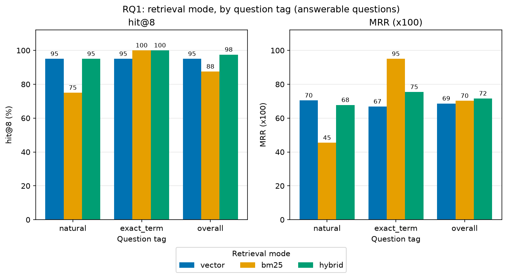

# RAG Studio Findings

## About this report

This report documents the research behind RAG Studio, a document question answering system that cites its sources and refuses to answer when the documents do not support an answer. It studies four questions: whether hybrid retrieval beats vector and keyword retrieval, how the relevance threshold trades answer rate against refusal accuracy, whether server side citation verification catches unsupported citations, and how chunk size affects retrieval and answers. RQ1 has been run (twice, see Amendment 2) and is written up below. RQ2 to RQ4 are pre-registered and their tooling is built, but they have not been run, because they need paid Claude API calls; their sections are added when they are run. The dataset that every experiment uses is described first.

## Research questions and hypotheses

The four research questions come from the design spec (section 2). Each run varies one setting and holds every other setting at the default configuration (chunk size 2000, hybrid retrieval, top 8, minimum similarity 0.35, citation verification on). The hypotheses below were written, with numeric thresholds, before any experiment was run. They were committed to git before the first run, so the git history shows that they precede the results. Differences are in percentage points on the 60 question set, which is small, so a difference under about 10 points is treated as within noise.

| ID | Research question | Hypothesis (falsifiable) |
|---|---|---|
| RQ1 | Does hybrid retrieval beat vector-only and BM25-only retrieval? | **H1:** On `exact_term` questions, hybrid hit@8 is at least 10 points above vector-only hit@8. On `natural` questions, hybrid hit@8 is within 5 points of vector-only hit@8 (not lower by more than 5). Overall, hybrid hit@8 is at least as high as the better of the two single modes. H1 is rejected if hybrid's `exact_term` gain over vector is under 10 points, or if hybrid is more than 5 points below vector on `natural`. |
| RQ2 | How does the relevance threshold trade answer rate against refusal accuracy? | **H2:** Raising `MIN_SIMILARITY` from 0.20 to 0.60 lowers the answer rate on answerable questions monotonically (allowing one reversal of at most 5 points) and raises refusal recall on unanswerable questions. There is a threshold between 0.30 and 0.45 at which answer rate is at least 80% and refusal recall is at least 70%. H2 is rejected if no threshold in the sweep reaches both numbers. |
| RQ3 | Does server side citation verification catch unsupported or fabricated citations that prompting alone lets through? | **H3:** With verification off, citation validity is below 100% by at least 2 points (so there is something to catch). With verification on, the share of sentences that the judge rates unsupported is lower than with verification off by at least 3 points. H3 is rejected if citation validity without verification is 98% or higher, or if the unsupported sentence rate does not fall by 3 points. |
| RQ4 | How does chunk size affect retrieval and answer quality? | **H4:** Chunk size 1000 has hit@8 at least 5 points above chunk size 4000 (finer chunks rank evidence higher), while chunk size 4000 has an answer rate at least 5 points above chunk size 1000 (more context per chunk). H4 is rejected if either gap is under 5 points or has the opposite sign. |

**Amendment (2026-10-17, before RQ2–RQ4 runs).** H1 is unchanged: RQ1 had already been run when this amendment was written, so editing it would break pre-registration. The hypotheses above for H2 to H4 are not edited either; this block only makes their rejection conditions explicit, naming every clause that can fail.

- **H2 is rejected if any of these holds:** (a) answer rate is not monotonically non-increasing in `MIN_SIMILARITY`, allowing one reversal of at most 5 points; (b) refusal recall does not rise between 0.20 and 0.60 (recall at 0.60 not above recall at 0.20); (c) no threshold between 0.30 and 0.45 reaches answer rate of at least 80% and refusal recall of at least 70% together.
- **H3 is rejected if either testable claim fails:** (a) raw citation validity (computed from the model's sentences before verification, a property of the model that is identical in both arms because both replay the same cached drafts) is not below 100% by at least 2 points, that is, it is 98% or higher, which would mean prompting alone leaves nothing to catch; (b) the unsupported-sentence rate with verification on is not at least 3 points lower than with verification off. Post-verification citation validity (`citation_validity_post`) is 100% under verify_on by construction, because verification drops unknown labels; it is reported as a sanity check and is not tested.
- **H4 is rejected if either clause fails:** (a) hit@8 at chunk size 1000 is not at least 5 points above hit@8 at 4000; (b) the answer rate at 4000 is not at least 5 points above the answer rate at 1000.

**Amendment 2 (2026-10-17, before RQ2–RQ4 runs).** While estimating cost on a 5-question sample of RQ4, the outputs for chunk sizes 2000 and 4000 came out identical. Investigation showed a defect in the chunker: chunks never crossed segment boundaries, and most corpus segments are shorter than 2,000 characters, so the 2000 and 4000 settings produced the same chunks in every document, and the incident report's paragraph segments (196 characters on average) gave tiny chunks at any setting. RQ4 would therefore have measured nothing. The sample's results were discarded and not used. Chunks per document with the original chunker:

| Document | Chunks at 1000 | Chunks at 2000 | Chunks at 4000 |
|---|---|---|---|
| api-reference.md | 16 | 12 | 12 |
| employee-handbook.pdf | 18 | 11 | 11 |
| incident-2026-03-14.txt | 53 | 53 | 53 |
| product-spec-lr7.docx | 14 | 11 | 11 |
| release-notes.md | 15 | 13 | 13 |
| security-policy.html | 16 | 13 | 13 |

The fix (Task 16): consecutive segments are now packed into blocks, joined with a blank line while the block stays within `chunk_chars`, never across a PDF page change; a segment longer than `chunk_chars` is windowed alone exactly as before (overlap 15%). A packed chunk's location is shown as a range ("first – last"). H4's thresholds are unchanged. H1 was already evaluated once under the original chunker, so RQ1 was re-run under the new chunker (retrieval only, no API). The original run (`backend/research/results/rq1/20261016T193404Z.jsonl`, summary `summary-original-chunker.json`) remains in the repository, and H1 will be evaluated on both runs and reported side by side.

## Dataset

All experiments run on one self-written corpus about an invented company, Lumen Robotics, and on 60 hand-labelled questions about it. Every company, product, person, ticket and number in the corpus is fictional. Sources live in `backend/research/sources/`, the corpus is generated by `backend/research/build_corpus.py` (run from `backend/` as `.venv/bin/python research/build_corpus.py`) into `backend/research/corpus/`, and the questions are in `backend/research/questions.jsonl`. The build is deterministic, so rebuilding leaves the corpus byte-identical. `backend/tests/test_research_data.py` checks the counts, the schema and that every evidence snippet appears in the text that the application's own parsers extract from the corpus.

### Corpus composition

Six documents cover every format the application accepts. Word counts are measured on the text that `parse_file` returns (headings are not part of the text for Markdown, DOCX and HTML, so these counts are slightly below the raw word counts of the sources).

| Document | Format | Words | Segments | Content |
|---|---|---|---|---|
| `employee-handbook.pdf` | PDF | 2,213 | 11 pages | Working hours, vacation, sick leave, remote work, equipment, travel, expenses |
| `api-reference.md` | Markdown | 1,795 | 12 | Endpoints, authentication, rate limits, error codes such as E-4471 |
| `product-spec-lr7.docx` | DOCX | 1,681 | 11 | LR7-X2 and LR7-S1 dimensions, battery, sensors, safety, SKUs |
| `incident-2026-03-14.txt` | Plain text | 1,803 | 53 paragraphs | Postmortem of INC-20260314-07 with timestamps, tickets and action items |
| `security-policy.html` | HTML | 1,742 | 13 | Password rules, device rules, data retention periods, vulnerability deadlines |
| `release-notes.md` | Markdown | 1,635 | 13 | Releases v3.2.0 to v3.4.1 with dates and tracking numbers |

The PDF, DOCX and HTML files are rendered from Markdown sources (PDF with one page per section, DOCX with real heading styles, HTML as an `<article>` with `<h2>` sections). The PDF uses plain ASCII punctuation only, so text extraction does not alter characters. The documents deliberately overlap in topic and vocabulary: the API reference, release notes and incident report all mention error E-4471, the dispatch service and the v3.3.x releases, the product specification and API reference both describe charging and low battery behaviour, and the handbook and security policy both cover remote work and lost laptops. This gives retrieval realistic distractors.

### Question counts

| Tag | Count | Description |
|---|---|---|
| `natural` | 20 | Answerable, phrased in different words from the document |
| `exact_term` | 20 | Answerable, hinging on an identifier or exact number (error code, SKU, model number, version, ticket id, tracking number) |
| `unanswerable` | 20 | Plausible questions that the corpus does not answer |
| Total | 60 | |

Of the 40 answerable questions, 35 need one document and 5 need two documents (two `expected` entries each, all tagged `exact_term`). Answerable questions per document, counting every `expected` entry: release notes 9, security policy 8, handbook 7, API reference 7, product specification 7, incident report 7. Of the 20 unanswerable questions, 10 reuse an identifier that does appear in the corpus (LR7-X2, LR7-S1, E-4290, E-4472, E-5012, INC-20260314-07, v3.3.2), which makes their wording lexically close to real passages.

Within each document the evidence is spread through the text. As a fraction of the parsed document length, the evidence snippets sit at 0.06 to 0.96 (API reference), 0.06 to 0.96 (handbook), 0.03 to 0.94 (incident), 0.11 to 0.93 (specification), 0.10 to 0.95 (release notes) and 0.11 to 0.88 (security policy), with snippets in the first fifth, the middle and the last fifth of every document. A single chunk size therefore cannot cover all evidence, which is what the chunk size experiment needs.

### Labelling guidelines

**What counts as answerable.** A question is answerable if one passage of the corpus, or two passages in two different documents, state the answer directly. The answer must be stated, not inferred by arithmetic or by combining facts that the text does not link. A question about a value that a document implies but never gives is unanswerable. For two document questions each half of the question must be answered by a different document, and each document contributes one evidence snippet.

**How evidence snippets are chosen.** Each answerable question lists, for every document needed, one `evidence` string. It is a verbatim substring of the document's parsed text, 5 to 20 words long, chosen as the shortest span that contains the answer. It must not cross a heading (Markdown, DOCX and HTML headings are removed by the parsers), must occur exactly once in its document, and must be plain ASCII so that it survives PDF extraction. The tests compare after whitespace normalisation, which makes the check independent of line wrapping. A retrieved chunk counts as a hit when it contains the evidence of the expected document, so the label is tied to text rather than to a particular chunking.

**How the two answerable tags are written.** `exact_term` questions contain the literal identifier or number that the evidence contains, for example E-4471, INC-20260314-03, LUM-4560 or `31 March`. These are the cases where a keyword index should help and an embedding model may not. `natural` questions are written after the evidence and avoid its wording: they share at most three content words with the evidence, and 12 of 20 share one or none (for example, the evidence says a token is valid for 3600 seconds and the question asks how long an access credential stays usable).

**How unanswerable questions are made adjacent.** Each one is written by taking a passage that is answerable and changing the asked property to one the corpus does not state, while keeping the same entity. Examples: the LR7-S1 weight is given but its top speed is not; releases are listed up to v3.4.1 but nothing is said about v3.5.0; vacation and sick leave are covered but parental leave is not; error E-5012 is described but its HTTP status is not; the incident report names tickets and owners but not the customer or the cost. For every unanswerable question, key terms were searched for in the parsed corpus to confirm that no passage answers it. Ten of the twenty reuse an exact identifier from the corpus, to stress the keyword half of hybrid retrieval and any relevance gate built on it. The purely off-topic question is deliberately absent, because it is the easy case.

### Known limitations

The corpus and the questions were written by the same author, so question wording may echo the author's habits, and the `natural` paraphrases are probably easier than questions that real users would ask. The domain is a single fictional company with a technical, English language register; results may not transfer to legal, medical or conversational text. The corpus is small (about 10,900 words) compared with a real document collection, so retrieval is easier than at scale, and with 60 questions the differences between configurations must be large to be distinguishable from noise. Unanswerable questions are adjacent by design, so refusal accuracy here is a hard case and not an average case. Labels were checked by script and by hand but not by a second annotator. Finally, two facts are intentionally stated in two documents (for example the 256 waypoint limit and the LR7-S1 firmware requirement), so a retrieved chunk from the second document may be a correct answer that the label does not credit when the question lists only one of them.

## RQ1: Hybrid vs vector vs BM25 retrieval

### Method

RQ1 measures retrieval only: no LLM call and no API spend. For each of the 60 questions the harness retrieves the top 8 chunks in each of three modes and compares them with the labelled evidence. A retrieved chunk is a hit when it contains the evidence string of the expected document. hit@8 is the share of answerable questions with at least one hit in the top 8, and MRR is the mean reciprocal rank of the first hit; both are computed on the 40 answerable questions (20 `natural`, 20 `exact_term`). The 20 unanswerable questions are in the run but do not enter these metrics.

The modes are vector (local `BAAI/bge-small-en-v1.5` embeddings), BM25 (SQLite FTS5) and hybrid (20 vector and 20 BM25 candidates fused by reciprocal rank fusion with k=60). All use top 8 and chunk size 2000. Only the retrieval mode varies.

RQ1 was run twice, because the chunker was changed after the first run (Amendment 2):

| Run | Chunker | Raw records | Summary |
|---|---|---|---|
| Original | Chunks never cross segment boundaries | `backend/research/results/rq1/20261016T193404Z.jsonl` | `backend/research/results/rq1/summary-original-chunker.json` |
| Packed | Consecutive segments packed into blocks up to `chunk_chars` | `backend/research/results/rq1/20261016T200121Z.jsonl` | `backend/research/results/rq1/summary.json` |

### Results

All values are from the two summary files. n is 40 overall and 20 per tag; one question is 2.5 points overall and 5 points within a tag.

**Original chunker** (`summary-original-chunker.json`)

| Mode | hit@8 overall | hit@8 natural | hit@8 exact_term | MRR overall | MRR natural | MRR exact_term |
|---|---|---|---|---|---|---|
| vector | 0.975 | 1.000 | 0.950 | 0.826 | 0.823 | 0.829 |
| bm25 | 0.900 | 0.800 | 1.000 | 0.676 | 0.442 | 0.910 |
| hybrid | 0.975 | 1.000 | 0.950 | 0.796 | 0.668 | 0.925 |

**Packed chunker** (`summary.json`)

| Mode | hit@8 overall | hit@8 natural | hit@8 exact_term | MRR overall | MRR natural | MRR exact_term |
|---|---|---|---|---|---|---|
| vector | 0.950 | 0.950 | 0.950 | 0.686 | 0.704 | 0.668 |
| bm25 | 0.875 | 0.750 | 1.000 | 0.702 | 0.454 | 0.950 |
| hybrid | 0.975 | 0.950 | 1.000 | 0.716 | 0.678 | 0.754 |

The plot shows the packed-chunker run (`summary.json`).

### H1 verdict

H1 is **rejected on both runs**. The rejection comes from one clause, the `exact_term` gain; the other two clauses hold.

| Clause | Original chunker | Packed chunker |
|---|---|---|
| `exact_term`: hybrid at least 10 points above vector (rejected if under 10) | 0.950 vs 0.950, gain +0 points: fails | 1.000 vs 0.950, gain +5 points: fails |
| `natural`: hybrid not more than 5 points below vector | 1.000 vs 1.000, gap 0 points: holds | 0.950 vs 0.950, gap 0 points: holds |
| Overall: hybrid at least as high as the better single mode | 0.975 vs best single 0.975 (vector): holds, tied | 0.975 vs best single 0.950 (vector): holds |

Because the rejection rule is that H1 fails if the `exact_term` gain is under 10 points, a single failed clause is enough.

### Interpretation

Vector retrieval was already close to the ceiling on `exact_term` (0.95 under both chunkers), so a 10-point gain was almost out of reach: the best possible hybrid score is 1.00, which is 5 points above 0.95. The 10-point threshold was set without a pilot run, and that is a lesson for the next pre-registration: check the headroom of the baseline on a few questions before fixing a threshold.

BM25 alone reaches 1.000 hit@8 on `exact_term` under both chunkers but drops on `natural` (0.800 original, 0.750 packed, against 0.950 to 1.000 for vector). Under the packed chunker, hybrid matches BM25 on `exact_term` (1.000) and matches vector on `natural` (0.950). Under the original chunker hybrid matched vector on both tags (0.950 on exact_term, 1.000 on natural) and did not reach BM25's 1.000 on `exact_term`, so the combination of strengths appears in the packed run only. Each difference between hybrid and the better single mode on a tag is one or two questions, so this is suggestive and not established.

MRR separates the modes more than hit@8 on the tags, where the first correct chunk's rank matters: on `exact_term` under the packed chunker, hit@8 differs by 5 points between vector and BM25 (0.950 and 1.000) while MRR differs by 28.2 points (0.668 and 0.950); on `natural`, BM25 trails vector by 20 points on hit@8 (0.750 vs 0.950) and by 25.0 points on MRR (0.454 vs 0.704). The overall columns do not show this: under the packed chunker the overall MRR spread is 3.0 points (0.686 to 0.716) against 10 points for hit@8. Hybrid does not rank best everywhere: under the original chunker vector has the highest overall MRR (0.826, against 0.796 for hybrid), and on `exact_term` BM25 has the highest MRR under the packed chunker (0.950, against 0.754 for hybrid).

The chunker change moved hit@8 by at most 2.5 points overall (vector 0.975 to 0.950, BM25 0.900 to 0.875, hybrid unchanged) and by at most 5 points within a tag, which is inside the noise band this report declares (about 10 points on 60 questions). MRR moved more: vector overall fell from 0.826 to 0.686 (14.0 points), hybrid from 0.796 to 0.716 (8.0 points) and BM25 rose from 0.676 to 0.702 (2.6 points). Vector's MRR drop (14.0 points) exceeds the 10-point band declared for hit@8, and hybrid's (8.0 points) is close to it, so the chunker affects how highly the evidence ranks more than whether it is found in the top 8. This experiment does not identify the cause of the MRR shift. Packing produces fewer and larger chunks (see Threats to validity), and one plausible reason is that more passages compete within each chunk, but that was not tested.

### Threats to validity

- **Small, single-domain, self-written dataset.** 40 answerable questions, one fictional company, one author for corpus and questions (see Known limitations above). The differences reported here are a few questions each.
- **Ceiling effect.** Vector retrieval scores 0.95 or 0.975 on hit@8, so hit@8 has little room to separate the modes. This is the main reason H1's `exact_term` clause could not be met.
- **One embedding model.** Only `BAAI/bge-small-en-v1.5` was used. A weaker embedding model would leave more room for BM25 and hybrid to help, and a stronger one less.
- **hit@8 is generous at this corpus size.** With the packed chunker at chunk size 2000, the six documents produce 45 chunks in total (api-reference 7, employee-handbook 11, incident 6, product-spec 7, release-notes 7, security-policy 7), so the top 8 covers about 18% of all chunks. With the original chunker the total was 113 (12, 11, 53, 11, 13, 13 from the Amendment 2 table), so the top 8 covered about 7%. A larger collection would make hit@8 a harder test.
- **Two runs, one pre-registered hypothesis.** The packed run is a re-run after a chunker fix made while other results existed. Both runs are reported and neither is preferred; they agree on the verdict.

## RQ2–RQ4: pre-registered, not yet run

RQ2 (relevance threshold), RQ3 (citation verification) and RQ4 (chunk size) need paid Claude API calls, for answer generation and, in RQ3, for the judge. They were not run for budget reasons. No result for them exists, and none is implied. Their hypotheses and rejection conditions are in the table and the two amendments above, fixed in git before any of these runs.

The tooling is built and tested with a fake LLM. `make experiments` runs all four experiments and then regenerates the plots. It is estimated at about $4 to $5 on Claude Sonnet 5.5, and responses are cached on disk so a re-run replays identically. The estimate has not been checked against a real run. RQ3 also has a 30-sentence judge spot-check (`backend/research/spotcheck.py`), which needs human labels for the sentences; without them the judge's reliability is unmeasured. When the experiments are run, results will be appended to this report in new sections, and the hypotheses and amendments above will not be changed.

## Defaults

The app keeps `RETRIEVAL_MODE=hybrid`. RQ1 supports this: hybrid had the best or tied-best overall hit@8 under both chunkers (0.975 in both runs) and, under the packed chunker, tied BM25 for the best `exact_term` hit@8 (1.000). That support is limited, since H1 was rejected and the margins are one or two questions. `MIN_SIMILARITY=0.35` and `CHUNK_CHARS=2000` remain untested design defaults until RQ2 and RQ4 are run.
