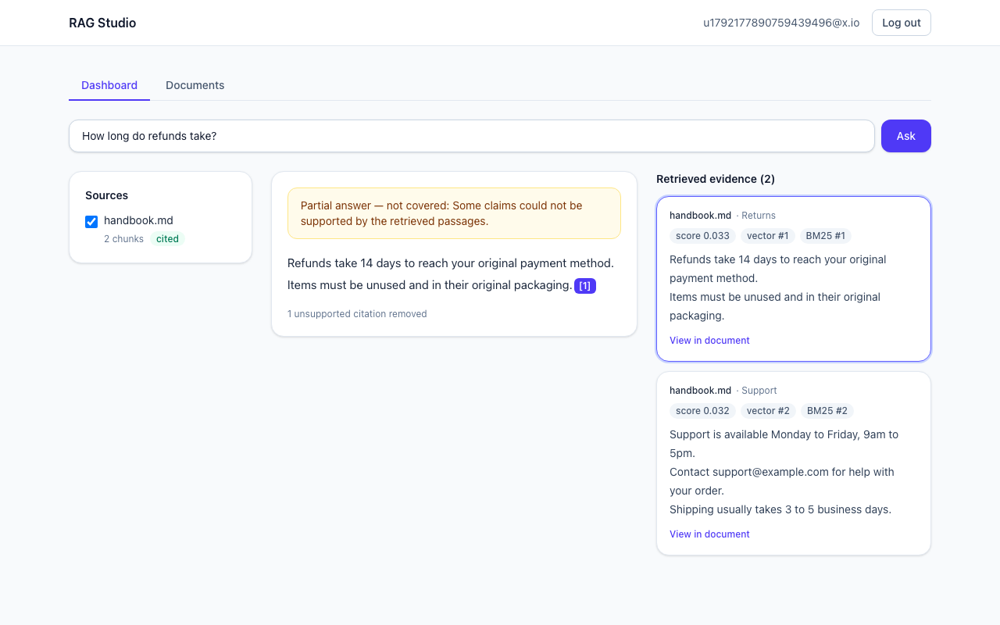
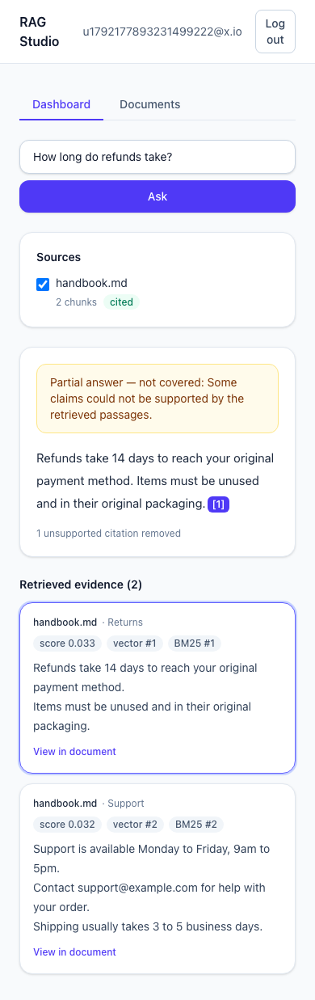
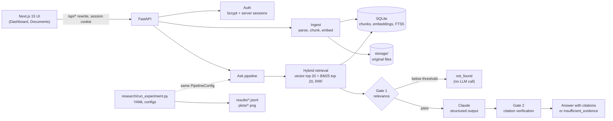

# RAG Studio

RAG Studio is an R&D project on grounded, abstaining document question answering: how do you build a system that answers only from the user's own documents, cites its evidence precisely, and refuses when the evidence is missing, and how do you measure that? It has two halves. The first is a working multi-user web app (upload PDF, DOCX, Markdown, text or HTML, or import a URL, then ask questions and click through numbered citations to the source passage). The second is a research harness that runs controlled experiments over the same configurable pipeline, on a self-written corpus and 60 labelled questions, to study retrieval mode, relevance threshold, citation verification and chunk size. The method, hypotheses, dataset and limitations are in [FINDINGS.md](FINDINGS.md); the design is in [docs/design/2026-10-17-rag-studio-design.md](docs/design/2026-10-17-rag-studio-design.md).

**Status:** RQ1 complete; RQ2–RQ4 pre-registered, tooling ready, not yet run (needs API credits).





## Architecture



Embeddings are computed locally (fastembed `BAAI/bge-small-en-v1.5`), so only answer generation and the experiment judge call the Claude API.

## Setup

Requires Python 3.12 (the system Python on macOS is older) and Node.

```bash
brew install python@3.12
make setup                          # backend venv + dependencies, frontend npm install
cp backend/.env.example backend/.env
# edit backend/.env and set ANTHROPIC_API_KEY
make dev                            # backend on :8000, frontend on :3000
```

The first ingest downloads the embedding model (about 130 MB).

### Running without an API key

```bash
LLM=fake EMBEDDER=hash make dev
```

This starts the backend on :8000 and the frontend on :3000 with a fake LLM and a hash-based embedder, so the whole UI works offline: upload, search, citations and refusals. The fake LLM returns the first sentence of the top passage plus one deliberately bad citation (`c99`), so citation verification visibly removes it. It only refuses in two cases: when no passage clears the relevance gate (for example an off-topic question such as "Who won the 1998 world cup?"), or when the question contains the word "unanswerable". The hash embedder is not semantic, so search quality is not representative. Real answers need `ANTHROPIC_API_KEY` in `backend/.env` and a plain `make dev`.

## Tests and experiments

```bash
make test          # backend pytest, frontend tsc, lint and Playwright
make experiments   # runs rq1 to rq4, then regenerates research/plots/
```

`make experiments` calls the real Claude API for RQ2 to RQ4 (generation, and the judge for RQ3), so it needs `ANTHROPIC_API_KEY` and costs money. Responses are cached on disk, so re-runs replay identically. RQ1 is retrieval only and needs no key: `cd backend && .venv/bin/python research/run_experiment.py research/experiments/rq1.yaml`. Raw per-question records are committed under `backend/research/results/`.

## Key results

Only RQ1 has been run so far. Retrieval over 40 answerable questions (hit@8 and MRR; 20 `natural`, 20 `exact_term`), default chunk size 2000. See the [plot](backend/research/plots/rq1_retrieval.png) and the full write-up in [FINDINGS.md](FINDINGS.md). H1 is rejected on both runs: hybrid's `exact_term` hit@8 gain over vector was +0 points (original chunker) and +5 points (packed chunker), against the 10 points the hypothesis required.

| Mode | hit@8 overall | hit@8 natural | hit@8 exact_term | MRR overall |
|---|---|---|---|---|
| vector | 0.950 | 0.950 | 0.950 | 0.686 |
| bm25 | 0.875 | 0.750 | 1.000 | 0.702 |
| hybrid | 0.975 | 0.950 | 1.000 | 0.716 |

These numbers are from the re-run under the packing chunker (`20261016T200121Z.jsonl`; see Amendment 2 in [FINDINGS.md](FINDINGS.md)). The original run under the earlier chunker is kept in [`backend/research/results/rq1/20261016T193404Z.jsonl`](backend/research/results/rq1/20261016T193404Z.jsonl), with its summary in [`summary-original-chunker.json`](backend/research/results/rq1/summary-original-chunker.json).

| Research question | Result |
|---|---|
| RQ1 retrieval mode | H1 rejected on both runs (`exact_term` gain +0 / +5 points, needed 10); hybrid best or tied on overall hit@8 |
| RQ2 relevance threshold | pre-registered, not run (needs API credits) |
| RQ3 citation verification | pre-registered, not run (needs API credits) |
| RQ4 chunk size | pre-registered, not run (needs API credits) |

## Next steps

Out of scope for v1 and candidates for follow-up research:

- OCR for scanned PDFs
- Streaming responses
- Chat history and follow-up questions
- Password reset and email verification
- Deployment
- Document sharing between users
- An in-app experiments UI
- Public benchmark datasets (for example SQuAD 2.0 unanswerables)
- Pin outbound connections to validated IPs (DNS-rebinding hardening for URL import)
